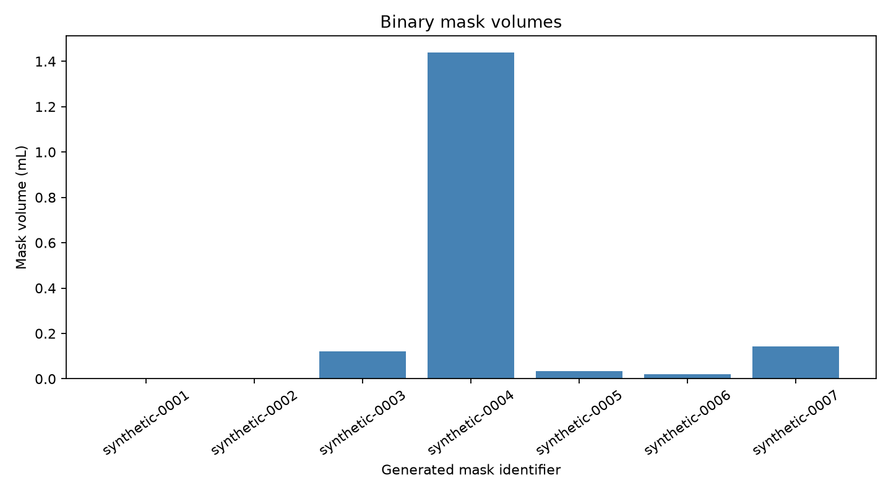
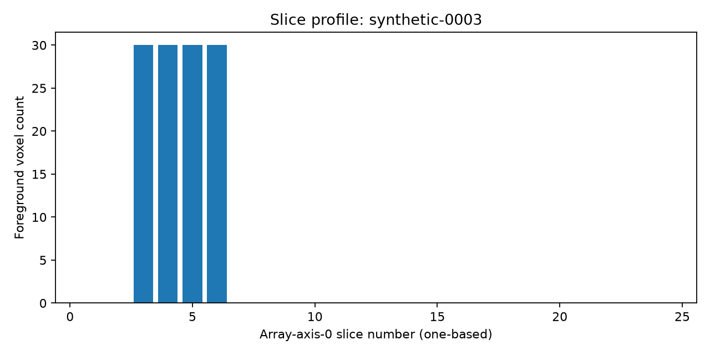

# Binary Mask Analyzer

A local Python tool for measuring existing binary 3D NIfTI masks, with a
procedural example collection and a SQLite results registry.

## Included example data

All seven bundled masks are generated from integer-indexed geometric boxes
by `mask_analyzer/synthetic.py`. They contain no human data. Every expected
voxel count follows directly from the dimensions of the defined boxes.
See [DATA_PROVENANCE.md](DATA_PROVENANCE.md) and the example manifest.

| Example | Foreground voxels | Voxel volume (mm³) | Foreground volume (mL) |
| --- | ---: | ---: | ---: |
| Empty array foreground | 0 | 1 | 0 |
| Single voxel | 1 | 1 | 0.001 |
| Box | 120 | 1 | 0.120 |
| Anisotropic box | 60 | 24 | 1.440 |
| Two disjoint boxes | 35 | 1 | 0.035 |
| Offset box | 42 | 0.5 | 0.021 |
| Rotated grid | 24 | 6 | 0.144 |

These are software-verification examples, not patient images or evidence
of performance on clinical populations.

## Setup

Use Python 3.12 or 3.13. Independent verification used Python 3.12.14 on Linux.
From the project directory, on macOS/Linux:

```bash
python3 -m venv .venv
source .venv/bin/activate
python -m pip install -r requirements.txt
python -m pytest -q
```

## Run the complete synthetic demo

```bash
python -m mask_analyzer demo --output results/demo
python -m mask_analyzer list results/demo/registry.sqlite3
```

This generates a new seven-mask collection, analyzes it, and creates:

- `registry.sqlite3`: local measurements, with a separate run identifier per run;
- `measurements.csv` and `summary.csv`;
- `volumes.png` and `slice_profile.png`;
- a generation manifest containing geometry definitions and file checksums.

Plots are saved directly; a graphical desktop is not required. Repeated demo
runs append to the database and use separate generated-data subdirectories.
CSV files and plots describe the latest run, while SQLite retains earlier runs.

A populated synthetic-only database and example reports are also provided in
`examples/demo-report/`. The bundled database uses the fixed demonstration run
identifier `synthetic-demo-v1`.

## Example figures





## Analyze your own authorized masks

```bash
python -m mask_analyzer analyze /path/to/mask.nii.gz --output results/local
python -m mask_analyzer batch /path/to/masks --output results/local
```

The batch command recursively reads `.nii` and `.nii.gz` files. Put only
binary segmentation masks in the input directory. Validation failure stops the
run; inputs must have non-empty 3D arrays, finite binary values, finite spatial
geometry, and millimeter spatial units. Values within absolute tolerance
`1e-6` of zero or one are normalized before counting; relative tolerance is zero.

Volume is the foreground voxel count multiplied by the absolute determinant
of the spatial affine matrix, divided by 1000 to convert mm³ to mL.
Slice counts follow array axis 0. Slice numbers start at one, and an empty
foreground has no peak slice. Anatomical orientation is not inferred.

## Results database and privacy

The database stores generated identifiers, dimensions, foreground counts,
physical volumes, source category, and per-slice counts. It stores no input
paths, original filenames, patient fields, personal names, email addresses,
usernames, hostnames, or activity timestamps. SQL inserts use bound parameters.
The runtime package has no networking or subprocess functionality.

User-input measurements can still be sensitive scientific data. Generated
local outputs are ignored by Git. Review any additional inputs, screenshots,
logs, or outputs before sharing them. Only the explicitly procedural examples
are part of this distribution. See [PRIVACY.md](PRIVACY.md).

## Provenance, dependencies, and code licensing

The sample collection is newly generated from the bundled mathematical
specifications. No external dataset files, measurements, metadata, images,
logos, or earlier repository history are included.

External software libraries retain their own licenses; acknowledgments are in
[DEPENDENCIES.md](DEPENDENCIES.md). The source code, original documentation, and procedural examples are licensed
under the custom [Lawful Use and Attribution License](LICENSE), version 1.0.
Lawful use, modification, redistribution, and commercial use are permitted
with attribution and preservation of the required notices. Separate approval
is not required. Users are responsible for their own conduct and permissions
for their input data. See [CITATION.md](CITATION.md) for attribution guidance.
This is a custom license, not MIT; no OSI approval is claimed.

## Scope

This is a research and education utility for supplied masks. It does not
establish segmentation accuracy or clinical validity. It does not validate
whether a user has permission to analyze an arbitrary input file.

## Distribution review

This distribution contains only the standalone project and its procedural
examples. Packaging, verification metadata, and the Persian guide were updated;
runtime source, tests, license terms, and attribution requirements are unchanged.
See [RELEASE_REVIEW.md](RELEASE_REVIEW.md) for the checks and their scope.
